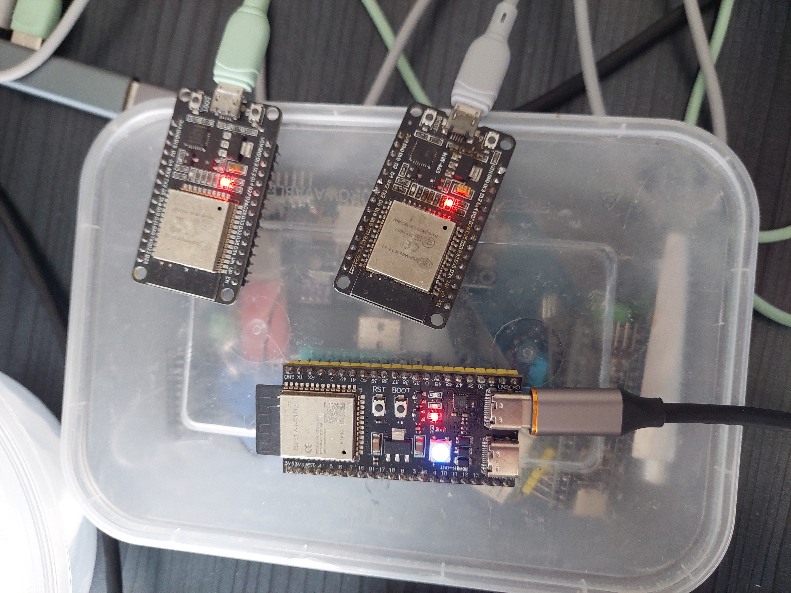
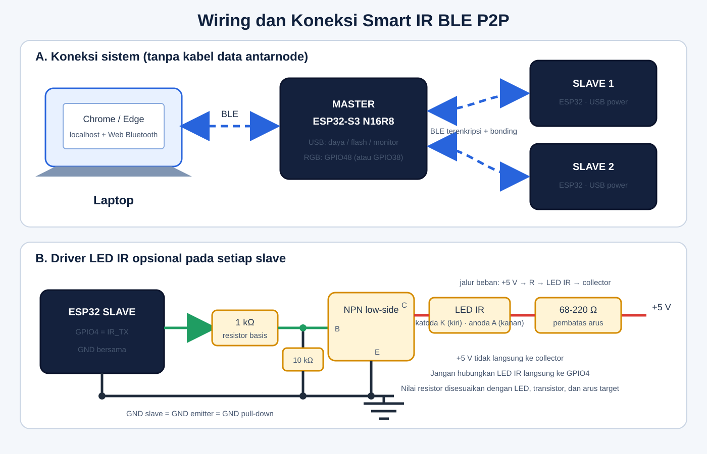

# Smart IR BLE P2P Connection

## Deskripsi singkat proyek

Proyek ini membangun jaringan Bluetooth Low Energy (BLE) point-to-point untuk
mengendalikan beberapa node Smart IR. Satu **master ESP32-S3 N16R8** menjadi
penghubung antara web app di laptop dan maksimal tiga **slave ESP32**. Master
berperan sebagai BLE peripheral terhadap laptop sekaligus BLE central terhadap
slave. Setiap slave menyimpan ID dan konfigurasi operasinya di NVS.

Web app berjalan lokal di Chrome/Edge melalui Web Bluetooth. Transport ke slave
bersifat *demand-driven*: master hanya memindai dan menghubungi slave ketika ada
provisioning, permintaan status, atau command yang perlu dikirim.



Foto di atas memperlihatkan satu board master ESP32-S3 N16R8 dan dua board
slave ESP32 yang digunakan pada pengujian.

## Target sistem

- Menghubungkan satu master dengan maksimal tiga slave melalui BLE.
- Melakukan provisioning ID, waktu *deep sleep*, dan *awake timeout* slave dari
  web app.
- Mengirim command `START`, `STOP`, status, dan state AC melalui protokol BLE
  dengan CRC-16.
- Menyimpan konfigurasi, status operasi, antrean command, dan bonding di NVS
  agar tetap tersedia setelah restart.
- Menghemat daya slave menggunakan *deep sleep* dan membangunkannya secara
  periodik untuk menerima pekerjaan.
- Menjadi dasar sistem Smart IR multi-node tanpa memerlukan kabel komunikasi
  antara master dan slave.

## Alat yang dibutuhkan

| Jumlah | Alat | Keterangan |
| --- | --- | --- |
| 1 | ESP32-S3 N16R8 | Master BLE dan antarmuka konfigurasi laptop. |
| 1-3 | ESP32/ESP32-WROOM-32 | Slave BLE; pengujian saat ini menggunakan dua slave. |
| 1 | Laptop/PC dengan Bluetooth | Menjalankan Chrome/Edge dan web app lokal. |
| Sesuai board | Kabel USB data | Untuk daya, flashing, dan serial monitor. |
| Opsional per slave | LED IR + transistor NPN/MOSFET | Tahap keluaran IR; jangan menggerakkan LED IR langsung dari GPIO. |
| Opsional per slave | Resistor basis/gate dan resistor LED | Contoh diagram: 1 kΩ, 10 kΩ, dan 68-220 Ω; sesuaikan dengan LED serta sumber daya. |
| Opsional | Breadboard dan jumper | Untuk merakit driver LED IR. |

Software yang digunakan adalah ESP-IDF v5.5.4, Python untuk server web lokal,
serta Chrome/Edge yang mendukung Web Bluetooth.

## Wiring



Tidak ada kabel data antara master dan slave; koneksi antarnode menggunakan
BLE. Semua board dapat diberi daya melalui USB masing-masing.

### Master ESP32-S3 N16R8

| Fungsi | Pin/koneksi default |
| --- | --- |
| Daya, flash, dan monitor | USB board |
| RGB status bawaan | GPIO48; beberapa board v1.1 memakai GPIO38 |
| Factory reset opsional | Push button eksternal GPIO2 ke GND; input memakai pull-up internal |

### Slave ESP32

| Fungsi | Pin/koneksi default |
| --- | --- |
| Daya, flash, dan monitor | USB board |
| Sinyal driver IR | GPIO4 → resistor basis/gate → transistor |
| Referensi driver IR | GND slave disatukan dengan GND rangkaian driver |

Untuk tahap IR, GPIO4 hanya memberi sinyal kendali. LED IR harus memakai
transistor driver dan resistor pembatas arus. Nilai komponen pada diagram adalah
contoh awal, bukan pengganti perhitungan sesuai tipe LED, transistor, dan arus
yang diinginkan.

## Sistem kerja

1. Slave menyala atau bangun dari *deep sleep*, lalu mengiklankan nama,
   manufacturer data, status provisioning, dan ID-nya.
2. Web app di laptop terhubung ke master melalui Web Bluetooth. Master membuka
   service konfigurasi dengan nama `Smart-IR-Master-XXXXXX`.
3. Pengguna menjalankan scan atau memasukkan command melalui web app. Master
   memulai scan BLE hanya ketika pekerjaan tersedia.
4. Master memilih slave berdasarkan identity address/ID, membuat koneksi,
   melakukan enkripsi dan bonding, menemukan GATT service, lalu berlangganan
   notifikasi status.
5. Slave mengirim `WAKE_STATUS`. Master kemudian mengirim command yang antre,
   dan slave membalas `ACK`, `NACK`, atau `AC_RESULT`.
6. Setelah antrean selesai, slave mengirim `PRE_SLEEP_STATUS`, memutus koneksi,
   lalu masuk *deep sleep* sesuai konfigurasi. Saat `STOP`, slave tetap standby
   dan tidak masuk *deep sleep*.
7. Konfigurasi dan antrean penting disimpan di NVS sehingga tidak hilang ketika
   perangkat di-restart.

Alur ringkas:

```text
Laptop/Web Bluetooth ↔ Master ESP32-S3 ↔ Slave ESP32 aktif
                                      ↳ slave lain menunggu/ deep sleep
```

## Hasil yang dicapai

- Master berhasil mendeteksi, memprovisioning, dan menyimpan dua slave dengan
  ID 1 dan ID 2.
- Kedua slave berhasil terhubung ulang, mengaktifkan notifikasi status, menerima
  command, mengirim respons, dan kembali advertising setelah disconnect.
- Web app berhasil menampilkan dua slave terdaftar beserta MAC, RSSI,
  advertised ID, dan status provisioning.
- Transport *demand-driven*, antrean command, bonding, NVS, `START`, `STOP`,
  status, dan siklus *deep sleep* telah tersedia.
- Bukti terminal dan web app tersedia pada folder [`results`](results/).

### Batasan versi saat ini

Driver slave sudah menyiapkan GPIO4 sebagai keluaran, tetapi encoder dan frame
IR Daikin **belum diimplementasikan** karena varian protokol AC belum ditentukan.
Command AC saat ini sengaja membalas `NACK_UNSUPPORTED`; jadi hasil pengujian
belum mencakup pengendalian AC fisik. Pembacaan baterai juga belum diaktifkan.

## Struktur folder

```text
P2P-connection/
├── master/   firmware ESP32-S3 dan web app konfigurasi BLE
├── slave/    firmware ESP32 slave
├── docs/     foto perangkat dan diagram wiring
└── results/  screenshot terminal dan web app
```

Petunjuk build, protokol, dan detail teknis tersedia pada
[`master/README.md`](master/README.md) dan [`slave/README.md`](slave/README.md).
