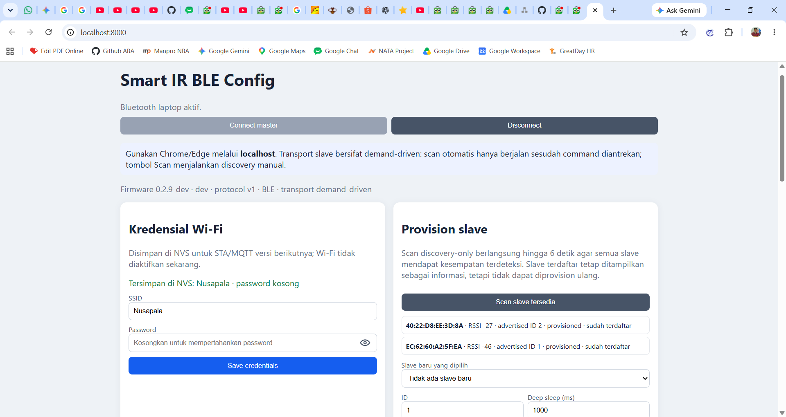

# Smart IR BLE Web Config

Aplikasi ini berjalan di laptop dan berkomunikasi langsung dengan ESP32-S3
master melalui Web Bluetooth. Master tidak membuka Wi-Fi AP atau HTTP server.

```powershell
cd tools\ble_web_config
.\start_server.ps1
```

Alternatif: `python server.py`. Buka `http://localhost:8000` dengan Chrome atau
Edge, lalu pilih `Smart-IR-Master-XXXXXX`. Firefox tidak mendukung Web Bluetooth.

Master menggunakan dual-role BLE secara bersamaan: menjadi peripheral/GATT server
untuk laptop dan central/GATT client untuk slave. Selama laptop terhubung, master
tetap memindai slave dan langsung mengeksekusi command yang diantrekan. Tombol
**Scan slave tersedia** mereset hasil penemuan, lalu menjalankan scan
discovery-only hingga 6 detik tanpa memutus Web Bluetooth. Selama scan manual,
master tidak membuka koneksi slave agar advertising beberapa slave dapat
terkumpul dalam satu hasil.

Provisioning memiliki dua tahap yang ditampilkan terpisah:

1. `menunggu ACK konfigurasi`: MAC dan target ID sudah disimpan di master, tetapi
   belum diterapkan oleh slave.
2. `konfigurasi terkonfirmasi`: master sudah menerima ACK `SET_CONFIG`, atau scan
   melihat slave mengiklankan ID target dengan flag provisioned.

Setelah menekan Provision atau Queue configuration, web boleh tetap terhubung.
Status ACK, advertised ID, RSSI, bonding, dan waktu terakhir slave terlihat dapat
dibaca langsung dengan me-refresh data pada sesi yang sama.

## Hasil pengujian web app

Tampilan berikut menunjukkan master terhubung melalui Web Bluetooth dan dua
slave yang sudah terdaftar serta terprovisioning.

<p align="center">
  
</p>
