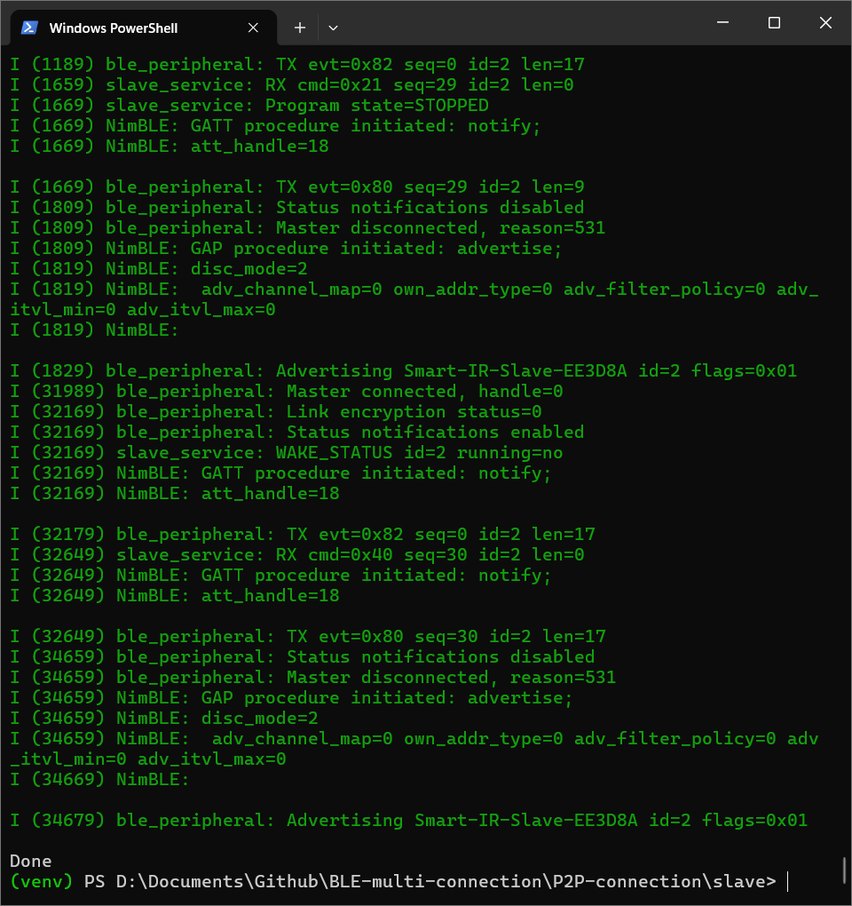

# Smart IR BLE Slave

Firmware ESP32-WROOM-32 untuk pasangan `Smart IR BLE Master`. Proyek memakai
ESP-IDF v5.5.4 dan target `esp32`.

## Fitur 0.1.1-dev

- NimBLE GATT peripheral dengan service/characteristic protokol v1 yang sama
  dengan master.
- Manufacturer data `FF FF 53 49 01 flags id`, sehingga master dapat mengenali
  slave sebelum koneksi GATT.
- LE Secure Connections Just Works, link encryption, bonding, dan penyimpanan
  bond pada NVS.
- Provisioning ID 0-255, deep sleep 1-1999 ms, dan safety awake timeout
  0 atau 2000-30000 ms.
- START menjalankan aplikasi dan mengizinkan deep sleep; STOP menjadi standby,
  tetap advertising dan menerima konfigurasi/START tanpa deep sleep.
- `WAKE_STATUS`, `ACK`, `NACK`, `AC_RESULT`, dan `PRE_SLEEP_STATUS` dalam frame
  biner dengan CRC-16/CCITT-FALSE.
- Konfigurasi dan state START/STOP persisten di NVS.
- Quiet window 250 ms setelah respons terakhir agar master dapat menguras
  antrean sebelum slave tidur.

## Hasil pengujian terminal slave

Pengujian menggunakan dua slave dengan ID 1 dan ID 2. Keduanya berhasil
advertising, terhubung ke master, mengaktifkan notifikasi status, menerima
command, dan kembali advertising setelah koneksi ditutup.

<table>
  <tr>
    <td align="center"><strong>Slave ID 1</strong></td>
    <td align="center"><strong>Slave ID 2</strong></td>
  </tr>
  <tr>
    <td></td>
    <td></td>
  </tr>
</table>

## Batasan AC pada versi ini

Driver IR menyiapkan GPIO output tetapi **belum memancarkan frame Daikin**.
Daikin memiliki beberapa keluarga frame yang tidak kompatibel. Sampai model AC
atau varian protokol (misalnya Daikin 152/176/216/280-bit) dipastikan, command AC
secara sengaja membalas `NACK_UNSUPPORTED`. Ini mencegah firmware melaporkan
berhasil padahal frame IR belum benar.

Default GPIO IR adalah GPIO4 dan harus menuju transistor driver IR LED, bukan
langsung membebani GPIO. Ubah melalui `idf.py menuconfig` pada menu
`Smart IR slave configuration`.

Pembacaan baterai juga belum diaktifkan karena pin ADC dan rangkaian pembagi
tegangan belum ditentukan; `battery_mv` dilaporkan 0.

## Build dan flash

```powershell
C:\esp\v5.5.4\esp-idf\export.ps1
idf.py set-target esp32
idf.py build
idf.py -p COMx flash monitor
```

Untuk flash pertama kali setelah firmware lama, bila bond/config lama
mengganggu pengujian gunakan `idf.py -p COMx erase-flash flash monitor`.

## Alur runtime

```text
boot/wake -> advertise -> master connect -> encrypt/bond -> subscribe
-> WAKE_STATUS -> command(s) -> ACK/NACK/AC_RESULT
-> 250 ms quiet -> PRE_SLEEP_STATUS -> deep sleep
```

Saat belum provisioned, slave tidak deep sleep. Saat STOP, slave juga tidak
deep sleep. Safety awake timeout memastikan slave yang sudah provisioned dan
RUNNING kembali tidur bila master tidak menyelesaikan transaksi.
